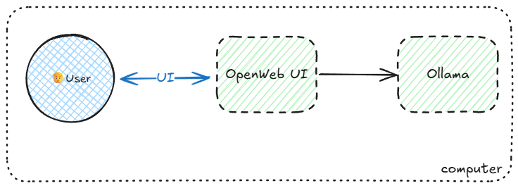
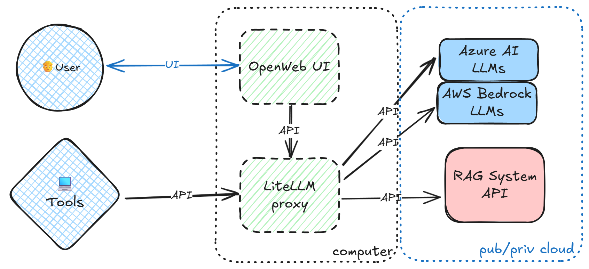
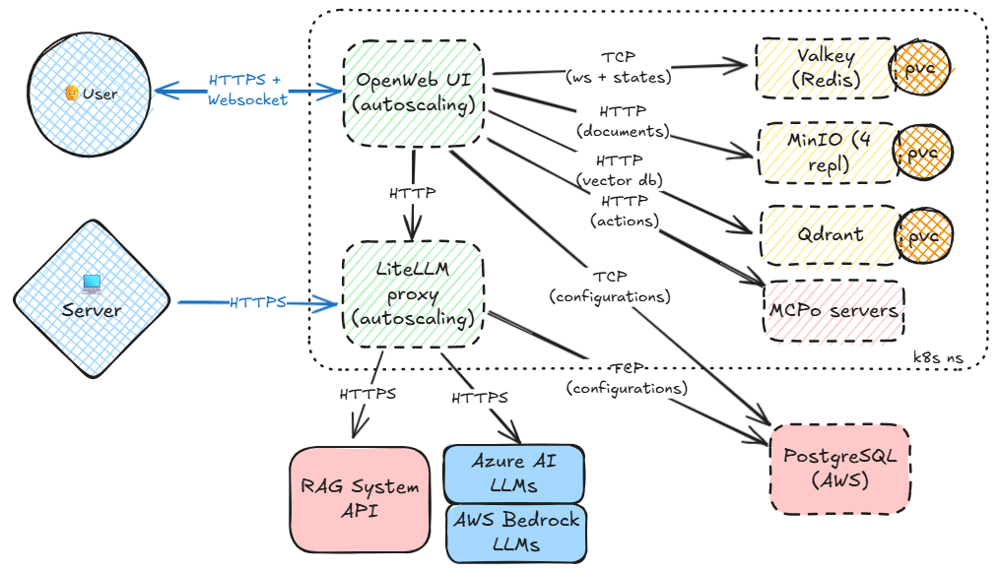

# owuilite

A getting started guide for adopting [Open WebUI][#openwebui] and [LiteLLM][#litellm].

## Overview

This repository provides multiple deployment configurations for running Open WebUI with LiteLLM, ranging from a simple single-container setup to a production-ready, autoscaling architecture with full observability. The configurations demonstrate progressive complexity:

- **Basic**: Single Open WebUI container for quick local testing
- **Intermediate**: Open WebUI + LiteLLM proxy for accessing public/private LLM APIs
- **Advanced**: Full autoscaling stack with PostgreSQL, pgvector, Valkey, and MinIO
- **Enterprise**: Complete solution with observability features using OpenTelemetry

## Pre-Requisites

Have docker and docker compose up and running.

## Getting Started

### Basic Setup (Single Container)

The fastest way to start using the Open WebUI chat application is to run it with Docker:

```bash
docker run --network=host -v open-webui:/app/backend/data --name open-webui ghcr.io/open-webui/open-webui:v0.13.0
```

<details>
<summary>Click to expand the diagram...</summary>


</details>

### Intermediate Setup (Open WebUI + LiteLLM)

An intermediate solution shows Open WebUI and LiteLLM running on the same host and exposing public/private LLMs APIs:

<details>
<summary>Click to expand the diagram...</summary>


</details>

### Advanced Setup (Full Autoscaling Stack)

All credentials live in a single `.env` file at the repository root, which Docker Compose reads automatically. Create it from the example and fill in your LLM provider keys (Anthropic, Azure OpenAI):

```bash
cp .env.example .env
```

The file is optional: without it, compose falls back to the same demo defaults, so `docker compose up` works with zero setup (models only answer once their provider keys are set). Variables exported in your shell take precedence over `.env`.

> [!WARNING]
> The default credentials (`sk-1234` LiteLLM master key, `password` database and MinIO passwords, `secret` session key, ...) are publicly known and meant for **local demos only**. Set your own values in `.env` before exposing the stack to any network you do not fully trust, and never commit `.env` (it is gitignored).

Then use docker compose to launch the complete autoscaling system:

```bash
docker compose up
```

<details>
<summary>Click to expand the system context diagram...</summary>



Systems deployed to run the solution :

| System | Description |
|--------|-------------|
| [Open WebUI][#openwebui]  | This is the main user interface. |
| [LiteLLM][#litellm]       | This is the LLMs proxy for exposing Azure LLMs through an OpenAI API specification. |
| [PostgreSQL][#postgresql] | SQL database used to store all configurations and persisted data for Open WebUI and LiteLLM. |
| [Valkey][#valkey]         | Valkey is a Redis alternative and is used to manage the Websockets for live interactivity with multiple running Open WebUI instances and sharing some cached states. |
| [pgvector][#pgvector]     | PostgreSQL extension used to store vectorized documents uploaded into Open WebUI and for RAG. |
| [MinIO][#minio]           | Object store used to store uploaded documents from Open WebUI in a central place. |
| [mcpo][#mcpo]             | To run officially supported [MCP servers][#mcpserver] for Agentic workflows via MCP. |

</details>

### Enterprise Setup (with Observability)

The final setup includes the autoscaling system combined with observability features for an enterprise-ready solution:

```bash
docker compose -f compose.yml -f otel.compose.yml up
```

## CLI Configuration

### Configure CLIs

Set the environment variables to point to local LiteLLM. The targets use `LITELLM_MASTER_KEY` from your shell or `.env`, falling back to the demo default `sk-1234`:

```bash
make claude
source envs/claude.env

make codex
source envs/codex.env
```

### Configure Codex

Configure Codex LiteLLM API endpoint:

```bash
cat > ~/.codex/config.toml << 'EOF'
# Recall that in TOML, root keys must be listed before tables.
model = "gpt-5-codex"
model_provider = "openai-chat-completions"

[model_providers.openai-chat-completions]
name = "LiteLLM using Responses API"
base_url = "http://localhost:4000"
env_key = "OPENAI_API_KEY"
wire_api = "responses"
EOF
```

## CI

GitHub Actions (`.github/workflows/ci.yml`) runs on every pull request and on pushes to `main`:

- `docker compose config -q` for `compose.yml` alone and with `otel.compose.yml` (using `.env.example` as the `.env` file)
- a check that `environment:` values in the compose files are not unquoted booleans (Compose v2 accepts them silently, Compose v1 rejects them)
- `yamllint` over all YAML files, using the repo's `.yamllint` config
- a JSON syntax check of `confs/mcp-config.json`
- a `gitleaks` secret scan of the full git history

To run the same checks locally:

```bash
cp -n .env.example .env
docker compose config -q
docker compose -f compose.yml -f otel.compose.yml config -q
yamllint .
jq empty confs/mcp-config.json
gitleaks git --redact .
```

[#openwebui]: https://github.com/open-webui/open-webui
[#litellm]: https://github.com/BerriAI/litellm
[#postgresql]: https://www.postgresql.org/
[#valkey]: https://github.com/valkey-io/valkey
[#pgvector]: https://github.com/pgvector/pgvector
[#minio]: https://github.com/minio/minio
[#mcpo]: https://github.com/open-webui/mcpo
[#mcpserver]: https://github.com/modelcontextprotocol/servers